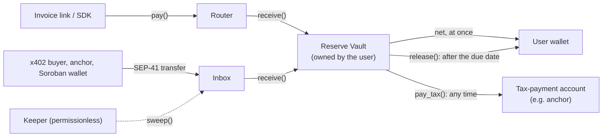

# Kyros Tax Vaults

**Real-time tax solvency for stablecoin income on Stellar.**

Kyros splits every stablecoin payment a user receives on Stellar and locks the tax part until it is due. The spendable amount reaches the user's wallet in the same transaction as the payment. The reserve sits in a Soroban vault the user owns, and before the due date it can only leave for the user's own tax-payment account. Kyros never holds funds or keys.

[](https://github.com/arturete58-sys/kyros2.0/actions/workflows/ci.yml)
[](https://github.com/arturete58-sys/kyros2.0/actions/workflows/testnet-demo.yml)



## Why

People paid in USDC or EURC receive the gross amount, but part of it is not theirs: VAT, income-tax prepayments, social contributions. Nothing sets that part aside, and it gets spent. Tax tools report after the fact; Kyros acts at the moment of payment and keeps the reserve where the user cannot spend it by mistake.

Every behaviour that matters is enforced by a contract:

| Behaviour | How |
| --- | --- |
| Split in the payer's own transaction | Router `pay()`: one payer signature, net to the owner, reserve to the vault, or nothing at all |
| Split payments from payers who know nothing about Kyros | Inbox: plain SEP-41 transfers, then a permissionless `sweep()` |
| Reserve locked until the due date | Vault `release()` refuses before the period's due date |
| Before the due date, only to the tax account | Vault `pay_tax()` pays the registered destination only |
| No instant redirection with a stolen key | New rule or destination waits for a notice period; both emit events |
| Proof of reserve without personal data | Contract state and events; only addresses, amounts and an invoice-reference hash go onchain |

## What is in the repository

| Path | Content |
| --- | --- |
| [`contracts/types`](contracts/types) | Shared types and pure functions: the split arithmetic and the UTC fiscal calendar |
| [`contracts/reserve-vault`](contracts/reserve-vault) | Reserve Vault: one per user, owner = user, no admin |
| [`contracts/router`](contracts/router) | Router: shared, stateless entry point for integrated payers |
| [`contracts/inbox`](contracts/inbox) | Inbox: one per user, a payment address that needs no integration |
| [`sdk`](sdk) | TypeScript SDK: client, split and calendar mirrors, SEP-7 links, event reader and CSV export, keeper |
| [`rule-packs`](rule-packs) | Rule-pack JSON schema and the Spain pack |
| [`test-vectors`](test-vectors) | Split and calendar cases checked by both the Rust and the SDK tests |
| [`docs`](docs) | Architecture, Stellar integration, rule packs, latest testnet run |

## The split

```text
base   = floor(gross * 10000 / (10000 + vat_bps))     VAT is included in the gross amount
vat    = gross - base
part_i = floor(base * bps_i / 10000)                  each other bucket is a share of the base
net    = gross - vat - sum(part_i)                    the parts always add up to the gross
```

A 1,210 USDC invoice with 21% VAT and a 20% income-tax prepayment: **800 to the user, 210 VAT and 200 income tax to the vault.**

## Quick start

Contracts (Rust, soroban-sdk 28):

```bash
cd contracts
cargo test                # unit and integration tests
stellar contract build    # kyros_reserve_vault.wasm, kyros_router.wasm, kyros_inbox.wasm
```

SDK (Node 20+):

```bash
cd sdk
npm ci && npm test
```

```ts
import { KyrosClient, loadRulePack, termsFromPack, invoiceReference, sep7TxUri, parseAmount } from 'kyros-sdk';

const kyros = new KyrosClient({ rpcUrl: 'https://soroban-testnet.stellar.org', networkPassphrase: 'Test SDF Network ; September 2015' });

// A vault with the Spain rule pack: VAT 21% + income-tax prepayment 20%, quarterly.
const terms = termsFromPack(loadRulePack('es'), 'general');
const vault = await kyros.deployVault(deployer, vaultWasmHash, {
  owner, taxDestination, noticeSecs: 7n * 86_400n, tokens: [USDC], ...terms,
});

// An invoice link the client opens in any SEP-7 wallet and signs once.
const tx = await kyros.prepare(client, kyros.payOp(ROUTER, {
  from: client, vault: vault.contractId, token: USDC, amount: parseAmount('1210'), reference: invoiceReference('INV-2027-001'),
}));
const link = sep7TxUri(tx, { msg: 'Invoice INV-2027-001' });
```

Keeper (pays only network fees; anyone can run one):

```bash
KEEPER_SECRET=S... npx kyros-keeper --network testnet --watch <inbox>:<token>
```

## Testnet

The [testnet demo workflow](.github/workflows/testnet-demo.yml) deploys the three contracts and runs the whole cycle with real transactions: a Router payment, an inbox payment swept by the keeper, a tax payment, a refused early release, a refused early change of destination, the release after the due date, and the CSV export. The latest results, with every transaction link, are in [docs/testnet](docs/testnet).

## Stellar building blocks

Soroban contracts and authorization · Stellar Asset Contracts (USDC, EURC) through the SEP-41 token interface · Stellar RPC (`simulateTransaction`, `sendTransaction`, `getEvents`) · SEP-7 transaction links · passkey (secp256r1) wallets · x402 on Stellar · SEP-24 anchors as tax-payment destinations. Details in [docs/stellar-integration.md](docs/stellar-integration.md).

## Status

Early, open-source and on testnet. The contracts have not been audited yet; do not use them with real funds before an audit.

Rule packs are information, not tax advice: they suggest percentages and dates, the user confirms them, and the contract enforces what the user chose.

## Team

- Arturo Ferrándiz Fernández, co-founder: product, regulation, contract design
- Clement Essien, co-founder and CTO: architecture and full stack ([@clemEssien](https://github.com/clemEssien))
- Frederik Bauer: smart contracts ([@Fredibau](https://github.com/Fredibau))

## License

Apache-2.0
