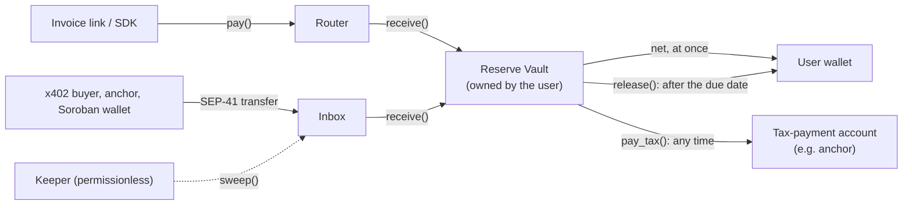

# Kyros Tax Vaults

**Real-time tax solvency for stablecoin income on Stellar.**

Kyros splits every stablecoin payment a user receives on Stellar and locks the tax part until it is due. The spendable amount reaches the user's wallet in the same transaction as the payment. The reserve sits in a Soroban vault the user owns, and before the due date it can only leave for the user's own tax-payment account. Kyros never holds funds or keys.

[](https://github.com/arturete58-sys/kyros2.0/actions/workflows/ci.yml)
[](https://github.com/arturete58-sys/kyros2.0/actions/workflows/testnet-demo.yml)



## Why

People paid in USDC or EURC receive the gross amount, but part of it is not theirs: VAT, income-tax prepayments, social contributions. Nothing sets that part aside, and it gets spent. Tax tools report after the fact; Kyros acts at the moment of payment and keeps the reserve where the user cannot spend it by mistake.

Every behaviour that matters is enforced by a contract:

| Behaviour | How |
| --- | --- |
| Split in the payer's own transaction | Router `pay()`: one payer signature, net to the owner, reserve to the vault, or nothing at all |
| Split payments from payers who know nothing about Kyros | Inbox: plain SEP-41 transfers, then a permissionless `sweep()` |
| Reserve locked until the due date | Vault `release()` refuses before the period's due date |
| Before the due date, only to the tax account | Vault `pay_tax()` pays the registered destination only |
| No instant redirection with a stolen key | New rule or destination waits for a notice period; both emit events |
| Proof of reserve without personal data | Contract state and events; only addresses, amounts and an invoice-reference hash go onchain |

## What is in the repository

| Path | Content |
| --- | --- |
| [`contracts/types`](contracts/types) | Shared types and pure functions: the split arithmetic and the UTC fiscal calendar |
| [`contracts/reserve-vault`](contracts/reserve-vault) | Reserve Vault: one per user, owner = user, no admin |
| [`contracts/router`](contracts/router) | Router: shared, stateless entry point for integrated payers |
| [`contracts/inbox`](contracts/inbox) | Inbox: one per user, a payment address that needs no integration |
| [`contracts/rate-registry`](contracts/rate-registry) | Rate Registry: dated VAT rates per country on-chain, published at least a fixed notice ahead; vaults can follow it |
| [`sdk`](sdk) | TypeScript SDK: client, split and calendar mirrors, VAT tables by date, reserve check with precision and objective targets, registry sync, country moves, SEP-7 links, event reader and CSV export, keeper |
| [`rule-packs`](rule-packs) | Rule packs for 42 jurisdictions: dated VAT tables, presets, fiscal calendars and tax estimates, with their JSON schema |
| [`test-vectors`](test-vectors) | Split and calendar cases checked by both the Rust and the SDK tests |
| [`docs`](docs) | Architecture, Stellar integration, rule packs, latest testnet run |

## The split

```text
base   = floor(gross * 10000 / (10000 + vat_bps))     VAT is included in the gross amount
vat    = gross - base
part_i = floor(base * bps_i / 10000)                  each other bucket is a share of the base
net    = gross - vat - sum(part_i)                    the parts always add up to the gross
```

A 1,210 USDC invoice with 21% VAT and a 20% income-tax prepayment: **800 to the user, 210 VAT and 200 income tax to the vault.**

## Any country, the user's own reserve

Each [rule pack](docs/rule-packs.md) carries the country's VAT tables with the dates they apply from, suggested presets and a simplified tax estimate. The user picks a VAT rate and the reserve they want; the SDK tells them whether that reserve is enough for their country, regime, activity and expected income. When a country's VAT changes, the vault switches on the legal date: either it follows the on-chain Rate Registry (no signature), or the owner signs the new rule once, ahead of time. Moving to another country moves the user's inbox to a vault built from the new country's pack, keeping the same payment address.

```ts
import { loadRulePack, checkReserve, vatUpdatePlan } from 'kyros-sdk';

checkReserve(loadRulePack('de'), 'standard', { revenue: 60_000, activity: 'software', reserveBps: 3000 });
// { status: 'short', requiredBps: 3115, owed: 18687, lines: [health insurance 10260, income tax 8427] }

vatUpdatePlan(loadRulePack('th'), 'vat-registered', { vatBps: 700, buckets: [{ name: 'income_tax', bps: 2000 }] }, 7 * 86_400);
// { action: 'schedule', rule: { vatBps: 1000, ... }, effectiveAt: 2027-10-01T00:00Z, signBy: 2027-09-24 }
// -> client.proposeRuleAtOp(vault, plan.rule, plan.effectiveAt), signed by the owner
```

## Quick start

Contracts (Rust, soroban-sdk 28):

```bash
cd contracts
cargo test                # unit and integration tests
stellar contract build    # kyros_reserve_vault.wasm, kyros_router.wasm, kyros_inbox.wasm
```

SDK (Node 20+):

```bash
cd sdk
npm ci && npm test
```

```ts
import { KyrosClient, loadRulePack, termsFromPack, invoiceReference, sep7TxUri, parseAmount } from 'kyros-sdk';

const kyros = new KyrosClient({ rpcUrl: 'https://soroban-testnet.stellar.org', networkPassphrase: 'Test SDF Network ; September 2015' });

// A vault from a rule pack: here Germany, VAT 19% + income tax reserve 30%.
const terms = termsFromPack(loadRulePack('de'), 'standard');
const vault = await kyros.deployVault(deployer, vaultWasmHash, {
  owner, taxDestination, noticeSecs: 7n * 86_400n, tokens: [USDC], ...terms,
});

// An invoice link the client opens in any SEP-7 wallet and signs once.
const tx = await kyros.prepare(client, kyros.payOp(ROUTER, {
  from: client, vault: vault.contractId, token: USDC, amount: parseAmount('1210'), reference: invoiceReference('INV-2027-001'),
}));
const link = sep7TxUri(tx, { msg: 'Invoice INV-2027-001' });
```

Keeper (pays only network fees; anyone can run one):

```bash
KEEPER_SECRET=S... npx kyros-keeper --network testnet --watch <inbox>:<token>
```

## Testnet

The [testnet demo workflow](.github/workflows/testnet-demo.yml) deploys the three contracts and runs the whole cycle with real transactions: a Router payment, an inbox payment swept by the keeper, a tax payment, a refused early release, a refused early change of destination, the release after the due date, and the CSV export. The latest results, with every transaction link, are in [docs/testnet](docs/testnet).

## Stellar building blocks

Soroban contracts and authorization · Stellar Asset Contracts (USDC, EURC) through the SEP-41 token interface · Stellar RPC (`simulateTransaction`, `sendTransaction`, `getEvents`) · SEP-7 transaction links · passkey (secp256r1) wallets · x402 on Stellar · SEP-24 anchors as tax-payment destinations. Details in [docs/stellar-integration.md](docs/stellar-integration.md).

## Status

Early, open-source and on testnet. The contracts have not been audited yet; do not use them with real funds before an audit.

Rule packs cover 46 jurisdictions ([docs/rule-packs.md](docs/rule-packs.md)): crypto hubs and low-tax jurisdictions (UAE, Bahrain, Switzerland, Liechtenstein, Monaco, Singapore, Hong Kong, Malta, Cyprus, Estonia, Portugal, Georgia, Andorra, El Salvador, Panama, Puerto Rico, the Bahamas, the Cayman Islands), the countries with the highest crypto adoption (India, the United States with all 50 states, Pakistan, Vietnam, Brazil, Nigeria, Indonesia, Ukraine, the Philippines, the UK, Japan, Argentina, South Korea, Thailand, Türkiye, Mexico, Colombia, Kenya, South Africa) and the main EU economies, Canada and Australia. Each pack also says who is tax resident there (so a freelancer in Bali gets Indonesia's rules, not their passport's), and Spain, the US, Canada, the UK and Germany are modelled by community, state, province, Scotland and church tax. Each preset says how far its reserve check can be trusted (exact, presumptive, exact on profit, estimate), and the recommended reserve adds a margin that grows with how strict the country is. A weekly [law watch](.github/workflows/law-watch.yml) compares the EU packs with the European Commission's official database and watches every official page the packs cite. Rule packs are information, not tax advice: they suggest percentages and dates, the user confirms them, and the contract enforces what the user chose.

## Team

- Arturo Ferrándiz Fernández, co-founder: product, regulation, contract design
- Clement Essien, co-founder and CTO: architecture and full stack ([@clemEssien](https://github.com/clemEssien))
- Frederik Bauer: smart contracts ([@Fredibau](https://github.com/Fredibau))

## License

Apache-2.0
