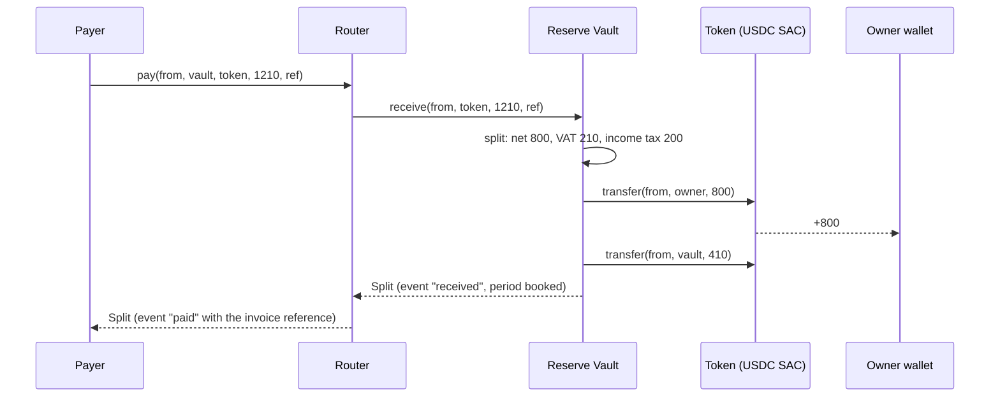
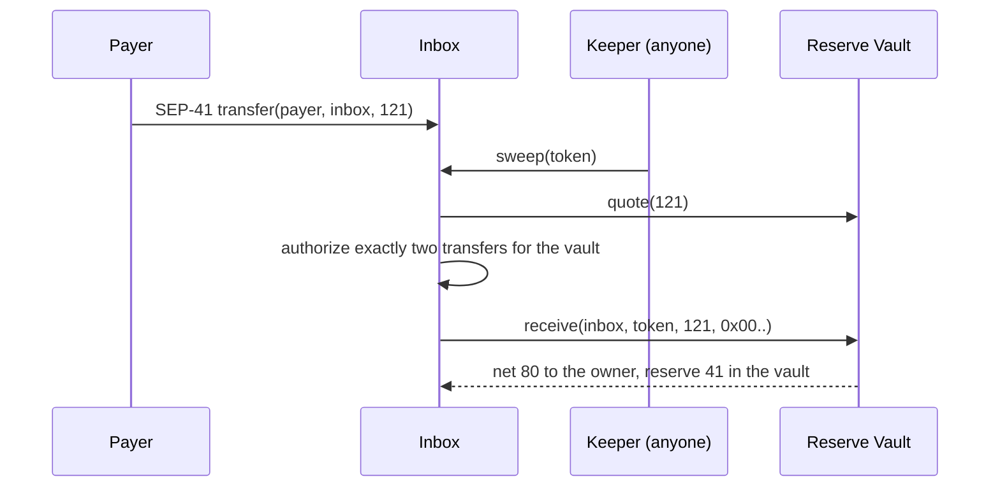
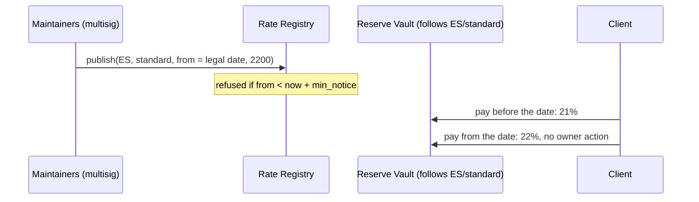
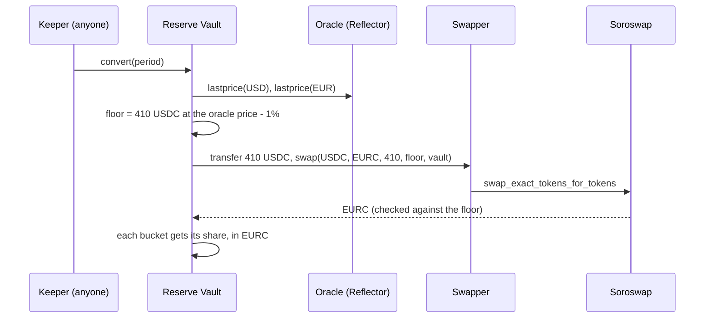

# Architecture

Four Soroban contracts hold every rule that touches money or rates, and two adapters connect the vault to other Stellar protocols. Everything off-chain (rule packs, keeper, indexer, web app) only suggests rules and shows balances; none of it holds funds or keys.

| Contract | Instances | Admin | Functions |
| --- | --- | --- | --- |
| Reserve Vault | one per user | none; the user is owner | `receive`, `quote`, `pay_tax`, `pay_tax_to`, `release`, `propose_rule`, `propose_rule_at`, `propose_destination`, `cancel`, `apply_pending`, `follow`, `unfollow`, `expect_invoice`, `forget_invoice`, `propose_conversion`, `stop_conversion`, `convert`, `propose_strategy`, `stop_strategy`, `invest`, `harvest`, reads |
| Router | one, shared | none, no storage | `pay`, `quote` |
| Inbox | one per user | none; moved only by the vault owner, with notice | `sweep`, `return_unaccepted`, `propose_vault`, `cancel_move` |
| Rate Registry | one per network | publisher (a multisig of rule-pack maintainers); holds no money | `seed`, `publish`, `withdraw`, `set_admin`, `rate`, `rate_at`, `schedule`, `min_notice` |
| Soroswap swapper | one, shared | none; holds nothing between calls | `swap` (the vault's `SwapApi`) |
| Blend yield strategy | one per vault that lends | none; only its vault moves funds | `deposit`, `withdraw`, `balance` (the vault's `YieldApi`) |

## Paying through the Router

The payer signs once. The vault applies the owner's rule and pulls both parts from the payer; either every transfer happens or none does.

## Paying into the Inbox

The payer only needs a SEP-41 transfer (x402 payments, anchors, Soroban-aware wallets). Classic payment operations cannot target contract addresses; those payers use an invoice link instead.

If no keeper runs, the money waits in the inbox, can only ever go to the owner and the vault, and anyone can sweep it. A token the vault does not accept goes back to the owner through `return_unaccepted`.

## One fiscal period in the vault

```mermaid
stateDiagram-v2
  [*] --> Accruing: first payment of the period
  Accruing --> Accruing: receive() adds to the buckets
  Accruing --> Locked: period ends
  Locked --> Locked: pay_tax() to the tax destination (allowed any time)
  Locked --> Releasable: each bucket's due date (VAT: its return date; income tax: the annual payment)
  Releasable --> [*]: release() returns what is left to the owner
```

Periods come from the rule pack: the VAT filing period in UTC (months, quarters, two-, four- or six-month periods, years), or a fixed number of seconds (used by the testnet demo). Each bucket has its own due date, from the country's official calendar ([rule packs](rule-packs.md)):

- a day of a month after the period, with one exception by the period's last month (Spain's VAT: the 20th after each quarter, 30 January for the fourth);
- a date after the fiscal year (Spain's income-tax reserve: 30 June of the next year; the UK's: 31 January two years after the tax year starts on 6 April);
- or a fixed delay.

Before its due date a bucket can only be paid to the tax destination; after it, `release` returns what is left of that bucket, and the buckets not yet due stay locked. `due_date(period)` is the latest of them, `bucket_due_date(period, bucket)` one of them. If the legal date falls on a weekend or holiday the deadline moves to the next working day; the vault does not move it, so pay on or before the date shown.

## Changes with notice

`propose_rule` and `propose_destination` record a change that takes effect after the vault's notice period; `propose_rule_at(rule, effective_at)` sets a later date, used to follow a scheduled VAT change: the owner signs ahead and the vault switches on the day the new rate applies, never before the notice has run; until then the old rule and destination apply, and the owner can `cancel`. Both the proposal and the change emit events, so the user, an accountant or the app sees a change coming. A stolen key therefore cannot redirect the reserve at once.

## VAT that follows the law

A vault can follow one rate in the Rate Registry (`follow(registry, country, rate, max_bps)`). From then on `quote` and `receive` read the registry's rate for that moment, and the user's reserves stay as they are. When the law changes, the registry entry's date is the day the vault changes, with no signature.

The contract checks:
- `follow` is refused unless the registry's `min_notice` is at least the vault's notice. It is also refused unless the registry's rate today equals the vault's VAT, so following changes nothing on day one.
- A rate above the owner's `max_bps` is ignored, and the vault keeps its own rule.
- `unfollow` applies at once and keeps the VAT in force as the vault's own.
- In the registry, entries that have started to apply cannot be edited or withdrawn.

## Expected payments with their own terms

`expect_invoice(reference, terms)` (owner) registers how the payments of one invoice split: its VAT, what the client withholds and pays to the tax authority itself (Spanish IRPF), and the reserve buckets. A payment carrying that reference is split with `split_withheld`; anything else follows the rule. Kyros does not issue invoices. See [expected-payments.md](expected-payments.md).

## Euro reserve, yield and anchors

`convert(period)` swaps a period's reserve into the currency the tax is owed in, through the swapper and the SEP-40 oracle the owner chose with notice, never below the oracle price minus the owner's tolerance. A yield strategy chosen with notice can hold up to a share of the reserve; the buckets keep their amounts, the owner takes what it earns with `harvest`, and payments out withdraw what they need. `pay_tax_to` pays the tax destination with an anchor's memo as muxed id. See [euro-reserve-yield-anchors.md](euro-reserve-yield-anchors.md).

## Moving country

`propose_vault(new_vault)` on the inbox needs the vault owner's signature, and the new vault must belong to the same owner. The move takes effect after the current vault's notice, and `cancel_move` withdraws it until then. The payment address stays the same. The old vault keeps its reserves, pays the old country's taxes from them and releases the rest on its own due dates. No locked money moves between vaults.

## Storage

- Instance: config (owner, rule, tax destination, notice, period kind, due rules per bucket, accepted tokens) and pending changes. Extended on every write.
- Persistent, one entry per period and token: reserve per bucket, total reserved, paid to the tax destination, released, converted. Extended on every write, to about 13 months.
- Instance: the conversion and the strategy, and their pending proposals.
- Persistent: what the buckets hold per token across periods (for yield), and the terms of each registered invoice.

## Errors

`InvalidRule`, `InvalidAmount`, `TokenNotAccepted`, `NotDue`, `NothingToRelease`, `ExceedsReserve`, `NoPendingChange`, `ChangeNotReady`, `UnknownBucket`, `NoTokens`, `AlreadyInForce`, `NotFollowing`, `RegistryNoticeTooShort`, `UnknownRate`, `RateMismatch`, `NoConversion`, `InvalidConversion`, `PriceUnavailable`, `SwapBelowFloor`, `NothingToConvert`, `NoStrategy`, `InvalidStrategy`, `StrategyInUse`, `Illiquid`, `WrongDestination`, `InvalidTerms`, `UnknownInvoice` (vault); `NothingToSweep`, `TokenAccepted`, `NotSameOwner`, `NoPendingMove`, `AlreadyMoved` (inbox); `TooSoon`, `InvalidRate`, `AlreadyInForce`, `NotFound`, `AlreadySeeded`, `TooManyEntries` (registry).

## Security notes

- No admin keys over money and no upgrade path. A new version is a new contract the owner moves to by choice. The Rate Registry has a publisher but holds no money; it can only change the VAT of vaults that chose to follow it, never sooner than its fixed notice, never above each owner's ceiling, and owners can stop following at any time.
- Integer arithmetic in 128 bits; every bucket rounds down and the remainder goes to the net amount, so the parts always add up to the gross. Shared test vectors check the same results in Rust and TypeScript.
- Each vault accepts an allow-list of tokens (USDC and EURC Stellar Asset Contracts).
- The swapper, the oracle and the yield strategy can each decide where reserve goes, so each one takes the vault's notice to set; stopping them applies at once. A conversion is refused below the oracle price minus the owner's tolerance or with a stale price; a strategy must name the vault as its only owner.
- Lending part of the reserve adds the lending protocol's risks (bad debt, waiting for liquidity); the owner chooses the share, and the buckets never change.
- The inbox authorizes only the two transfers the vault needs for a given sweep, with exact amounts and recipients.
- Not audited yet.
