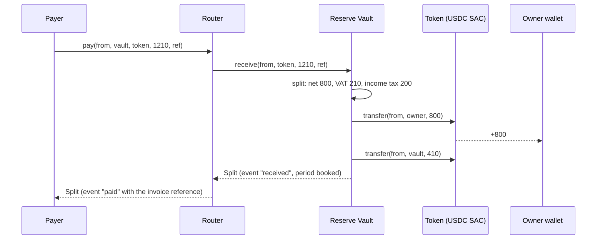
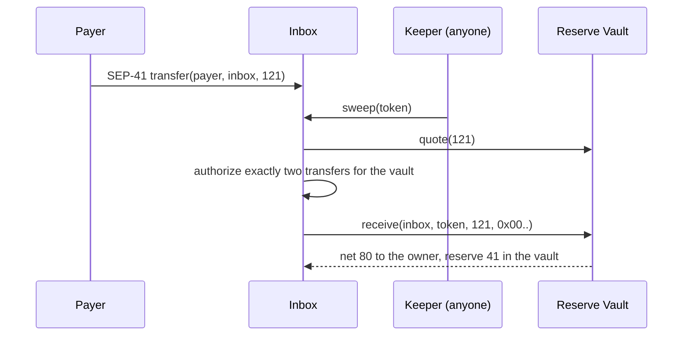
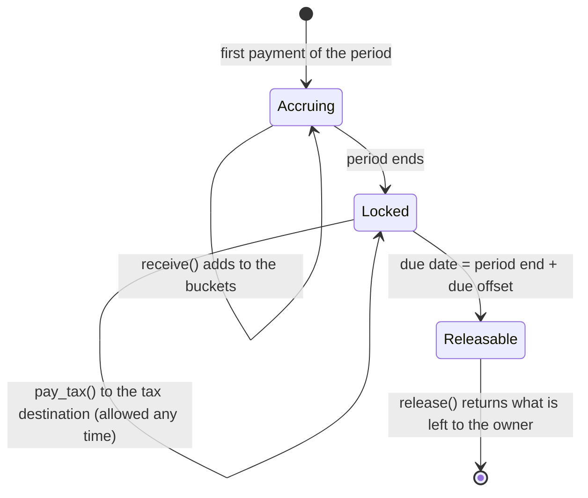

# Architecture

Three Soroban contracts hold every rule that touches money. Everything off-chain (rule packs, keeper, indexer, web app) only suggests rules and shows balances; none of it holds funds or keys.

| Contract | Instances | Admin | Functions |
| --- | --- | --- | --- |
| Reserve Vault | one per user | none; the user is owner | `receive`, `quote`, `pay_tax`, `release`, `propose_rule`, `propose_rule_at`, `propose_destination`, `cancel`, `apply_pending`, reads |
| Router | one, shared | none, no storage | `pay`, `quote` |
| Inbox | one per user | none; tied to the user's vault | `sweep`, `return_unaccepted` |

## Paying through the Router

The payer signs once. The vault applies the owner's rule and pulls both parts from the payer; either every transfer happens or none does.

## Paying into the Inbox

The payer only needs a SEP-41 transfer (x402 payments, anchors, Soroban-aware wallets). Classic payment operations cannot target contract addresses; those payers use an invoice link instead.

If no keeper runs, the money waits in the inbox, can only ever go to the owner and the vault, and anyone can sweep it. A token the vault does not accept goes back to the owner through `return_unaccepted`.

## One fiscal period in the vault

Periods come from the rule pack: calendar months, quarters or years in UTC (quarters for Spain, years where income tax is annual), or a fixed number of seconds (used by the testnet demo). The due date is the end of the period plus the pack's offset.

## Changes with notice

`propose_rule` and `propose_destination` record a change that takes effect after the vault's notice period; `propose_rule_at(rule, effective_at)` sets a later date, used to follow a scheduled VAT change: the owner signs ahead and the vault switches on the day the new rate applies, never before the notice has run; until then the old rule and destination apply, and the owner can `cancel`. Both the proposal and the change emit events, so the user, an accountant or the app sees a change coming. A stolen key therefore cannot redirect the reserve at once.

## Storage

- Instance: config (owner, rule, tax destination, notice, period kind, due offset, accepted tokens) and pending changes. Extended on every write.
- Persistent, one entry per period and token: reserve per bucket, total reserved, paid to the tax destination, released. Extended on every write, to about 13 months.

## Errors

`InvalidRule`, `InvalidAmount`, `TokenNotAccepted`, `NotDue`, `NothingToRelease`, `ExceedsReserve`, `NoPendingChange`, `ChangeNotReady`, `UnknownBucket`, `NoTokens`, `AlreadyInForce` (vault); `NothingToSweep`, `TokenAccepted` (inbox).

## Security notes

- No admin keys and no upgrade path. A new version is a new contract the owner moves to by choice.
- Integer arithmetic in 128 bits; every bucket rounds down and the remainder goes to the net amount, so the parts always add up to the gross. Shared test vectors check the same results in Rust and TypeScript.
- Each vault accepts an allow-list of tokens (USDC and EURC Stellar Asset Contracts).
- The inbox authorizes only the two transfers the vault needs for a given sweep, with exact amounts and recipients.
- Not audited yet.
