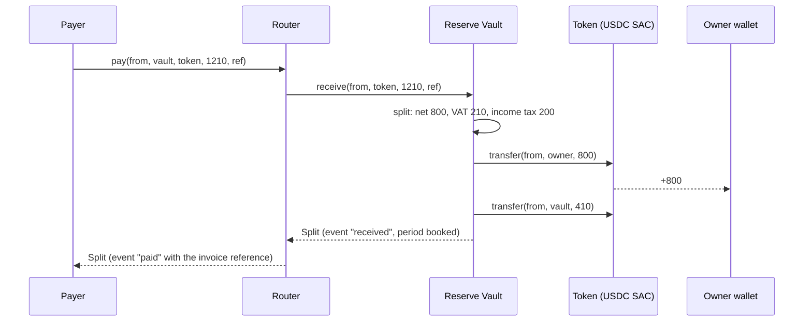
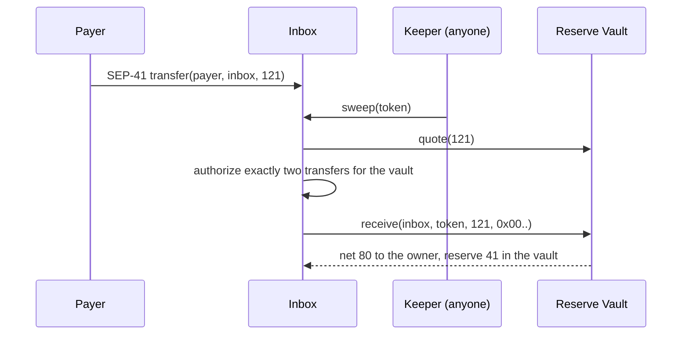
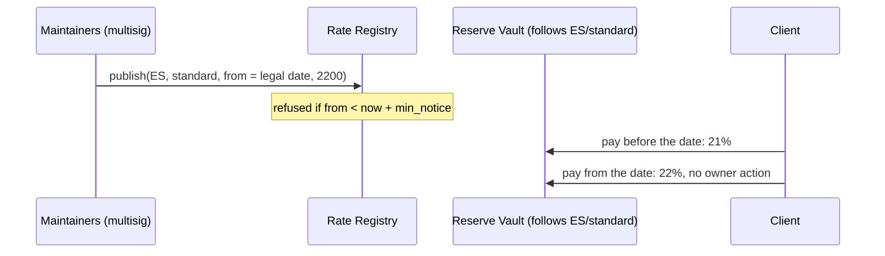
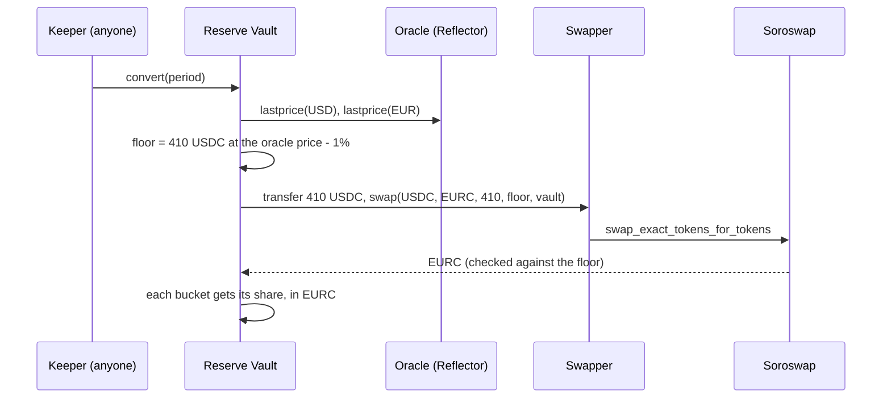

# Architecture

Four Soroban contracts hold every rule that touches money or rates, and two adapters connect the vault to other Stellar protocols. Everything off-chain (rule packs, keeper, indexer, web app) only suggests rules and shows balances; none of it holds funds or keys.

| Contract | Instances | Admin | Functions |
| --- | --- | --- | --- |
| Reserve Vault | one per user | none; the user is owner | `receive`, `quote`, `pay_tax`, `pay_tax_to`, `release`, `propose_rule`, `propose_rule_at`, `propose_destination`, `cancel`, `apply_pending`, `follow`, `unfollow`, `expect_invoice`, `forget_invoice`, `propose_conversion`, `stop_conversion`, `convert`, `propose_strategy`, `stop_strategy`, `invest`, `harvest`, reads |
| Router | one, shared | none, no storage | `pay`, `quote` |
| Inbox | one per user | none; moved only by the vault owner, with notice | `sweep`, `return_unaccepted`, `propose_vault`, `cancel_move` |
| Rate Registry | one per network | publisher (a multisig of rule-pack maintainers); holds no money | `seed`, `publish`, `withdraw`, `set_admin`, `rate`, `rate_at`, `schedule`, `min_notice` |
| Soroswap swapper | one, shared | none; holds nothing between calls | `swap` (the vault's `SwapApi`) |
| Blend yield strategy | one per vault that lends | none; only its vault moves funds | `deposit`, `withdraw`, `balance` (the vault's `YieldApi`) |

## Paying through the Router

The payer signs once. The vault applies the owner's rule and pulls both parts from the payer; either every transfer happens or none does.

## Paying into the Inbox

The payer only needs a SEP-41 transfer (x402 payments, anchors, Soroban-aware wallets). Classic payment operations cannot target contract addresses; those payers use an invoice link instead.

If no keeper runs, the money waits in the inbox, can only ever go to the owner and the vault, and anyone can sweep it. A token the vault does not accept goes back to the owner through `return_unaccepted`.

## One fiscal period in the vault

```mermaid
stateDiagram-v2
  [*] --> Accruing: first payment of the period
  Accruing --> Accruing: receive() adds to the buckets
  Accruing --> Locked: period ends
  Locked --> Locked: pay_tax() to the tax destination (allowed any time)
  Locked --> Releasable: each bucket's due date (VAT: its return date; income tax: the annual payment)
  Releasable --> [*]: release() returns what is left to the owner
```

Periods come from the rule pack: the VAT filing period in UTC (months, quarters, two-, four- or six-month periods, years), or a fixed number of seconds (used by the testnet demo). Each bucket has its own due date, from the country's official calendar ([rule packs](rule-packs.md)):

- a day of a month after the period, with one exception by the period's last month (Spain's VAT: the 20th after each quarter, 30 January for the fourth);
- a date after the fiscal year (Spain's income-tax reserve: 30 June of the next year; the UK's: 31 January two years after the tax year starts on 6 April);
- or a fixed delay.

Before its due date a bucket can only be paid to the tax destination; after it, `release` returns what is left of that bucket, and the buckets not yet due stay locked. `due_date(period)` is the latest of them, `bucket_due_date(period, bucket)` one of them.

### Weekends and public holidays

A legal due date can fall on a day the tax office is closed. Each rule pack says what its country does (`calendar.workdays`, with sources): the deadline moves to the next working day (Spain, Germany, Italy, France, Portugal, the US, Canada, Australia, Japan, Korea, Mexico, Turkey, Indonesia), it must be met the working day before (the UK, South Africa), or it does not move (the Netherlands, for taxes paid on a return). Countries whose rule is not verified are treated as "does not move". Holidays come from `rule-packs/holidays/<cc>.json`, generated from the [`holidays`](https://github.com/vacanza/holidays) package for 2025-2035, in two sets per year: `pay` (the holidays that legally move the date: national ones, every state's in Australia, Washington DC's for the IRS) and `lock` (every holiday of the country and all its regions).

Two dates come out of every deadline, and each errs on the safe side:

- the **date to pay by**, shown by the app: never later than the real deadline. With "next working day" it moves forward over the `pay` holidays only; otherwise it moves back to the last working day before the legal date (banks do not move money on closed days);
- the **lock**, enforced by the vault: never earlier than the real deadline, wherever the user lives. `next_open` (in `kyros_types`) moves the end of the due day forward past the vault's closed weekdays (`Dues.closed`, a bitmask; Saturday and Sunday at least) and past the holidays the Rate Registry publishes for the vault's country (`Dues.holidays`), at most `MAX_SHIFT_DAYS` (14). A registry that published wrong holidays could therefore keep a reserve locked two weeks longer at most, and never shorter. The same function runs in TypeScript and is checked against vectors from an independent Python calendar.

The registry takes a year's list until the year starts (or once, if it has none), and after that only holidays still to come (`add_holiday`), which can only make dates later. `sdk/scripts/sync-holidays.mjs` publishes the generated files; the law watch reruns the generator weekly with the newest `holidays` release and opens an issue if anything changed.

### Dates set by the tax office

In some countries the final payment date (and amount) comes in the tax office's notice (Germany, Switzerland, the Netherlands, Luxembourg, Singapore, and every advance payment the office notifies). The app reads the notice the user picks (a PDF's text layer, or pasted text) in the browser with `readNotice` (dates and amounts in seven languages, scored by the words around them), shows what it found to check, and the owner signs `set_due(bucket, from_period, to_period, day)`. A date later than the current one applies at once; an earlier one must still be at least the vault's notice period away, so the lock can never be opened suddenly. Each period stores the date as a day number, and it still moves past weekends and holidays.

### Prepayments and scheduled payments

Prepayments (Spain's modelo 130, the UK's payments on account, US estimated tax...) are paid from the income-tax buckets before the annual date. Each pack says how the amount is worked out (`calendar.prepayments[].amount`, see `installments.ts`): Spain's modelo 130 exactly, from what the vault records per period (`income`, the base of every payment; `withheld`, what clients withheld; `paid_buckets`, what was paid from each bucket) and the expenses the user types; a share of last year's tax; a share of the year's tax estimated from the reserve so far; what the reserve holds so far; or the amount on the tax office's notice.

`schedule(at, payments, to)` (owner) records a payment of one or more buckets to the tax destination (`to` may carry the anchor's memo as a muxed id). From `at` on anyone can call `run_scheduled(id)`: each item pays at most what its bucket holds, only to the destination in force, and the schedule is removed. `cancel_scheduled(id)` (owner) drops it. The app runs due payments with its fee payer when opened; the keeper does it with `--vault`; on testnet a public keeper workflow ([keeper.yml](../.github/workflows/keeper.yml)) runs every hour, finding vaults from their `payment_scheduled` events. One signature can therefore pay several buckets now (schedule for now, then run) or later.

## Changes with notice

`propose_rule` and `propose_destination` record a change that takes effect after the vault's notice period; `propose_rule_at(rule, effective_at)` sets a later date, used to follow a scheduled VAT change: the owner signs ahead and the vault switches on the day the new rate applies, never before the notice has run; until then the old rule and destination apply, and the owner can `cancel`. Both the proposal and the change emit events, so the user, an accountant or the app sees a change coming. A stolen key therefore cannot redirect the reserve at once.

## VAT that follows the law

A vault can follow one rate in the Rate Registry (`follow(registry, country, rate, max_bps)`). From then on `quote` and `receive` read the registry's rate for that moment, and the user's reserves stay as they are. When the law changes, the registry entry's date is the day the vault changes, with no signature.

The contract checks:
- `follow` is refused unless the registry's `min_notice` is at least the vault's notice. It is also refused unless the registry's rate today equals the vault's VAT, so following changes nothing on day one.
- A rate above the owner's `max_bps` is ignored, and the vault keeps its own rule.
- `unfollow` applies at once and keeps the VAT in force as the vault's own.
- In the registry, entries that have started to apply cannot be edited or withdrawn.

## Expected payments with their own terms

`expect_invoice(reference, terms)` (owner) registers how the payments of one invoice split: its VAT, what the client withholds and pays to the tax authority itself (Spanish IRPF), and the reserve buckets. A payment carrying that reference is split with `split_withheld`; anything else follows the rule. Kyros does not issue invoices. See [expected-payments.md](expected-payments.md).

## Clients abroad and corrections

The chain does not say where a payer is, so the usual payment address keeps reserving VAT (the safe side) and clients abroad get a second one:

- `expect_payer(payer, terms)` (owner) registers terms for a payer address, used by `receive` when a payment has no invoice terms. The app makes a second inbox on first use and registers it with no VAT and the same income-tax buckets; payments through it split that way. The Inbox and the CCTP receiver authorize exactly the transfers `quote_for(from, reference, gross)` returns, which applies the same terms as `receive`. A client wallet can be registered the same way, so its payments through the Router or a payment link split by its terms. `forget_payer` removes them.
- When a wallet seen paying the address for clients abroad pays the usual one, the app offers to take that VAT back: `propose_correction(period, token, bucket, amount)` (owner, at most what the bucket holds) can be applied by anyone with `apply_correction` once the vault's notice has passed, and pays the owner at most what the bucket still holds; the owner can `cancel_correction` until then. The app and the keeper apply ready corrections. At most 20 are open at once.

## Euro reserve, yield and anchors

`convert(period)` swaps a period's reserve into the currency the tax is owed in, through the swapper and the SEP-40 oracle the owner chose with notice, never below the oracle price minus the owner's tolerance. A yield strategy chosen with notice can hold up to a share of the reserve; the buckets keep their amounts, the owner takes what it earns with `harvest`, and payments out withdraw what they need. `pay_tax_to` pays the tax destination with an anchor's memo as muxed id. See [euro-reserve-yield-anchors.md](euro-reserve-yield-anchors.md).

## Moving country

`propose_vault(new_vault)` on the inbox needs the vault owner's signature, and the new vault must belong to the same owner. The move takes effect after the current vault's notice, and `cancel_move` withdraws it until then. The payment address stays the same. The old vault keeps its reserves, pays the old country's taxes from them and releases the rest on its own due dates. No locked money moves between vaults.

## Agents off-chain

Ten agents in the SDK read, check and prepare without holding funds or keys: law, documents, treasury (euros and Blend yield), payouts, reconciliation, residence and moves, x402 billing, expenses, the guardian (pending changes and how to stop them) and settlement through an anchor. The app's Assistant tab answers questions with them on the user's device. See [agents.md](agents.md).

## Storage

- Instance: config (owner, rule, tax destination, notice, period kind, due rules per bucket, accepted tokens) and pending changes. Extended on every write.
- Persistent, one entry per period and token: reserve per bucket, total reserved, paid to the tax destination (in total and per bucket), released, converted, income booked and income tax withheld by clients. Extended on every write, to about 13 months.
- Persistent: due dates set from a notice, per period and bucket, and scheduled payments; instance: the list of open scheduled payments (at most 40).
- Instance: the conversion and the strategy, and their pending proposals.
- Persistent: what the buckets hold per token across periods (for yield), the terms of each registered invoice and payer, and open corrections; instance: the list of open corrections (at most 20).

## Errors

`InvalidRule`, `InvalidAmount`, `TokenNotAccepted`, `NotDue`, `NothingToRelease`, `ExceedsReserve`, `NoPendingChange`, `ChangeNotReady`, `UnknownBucket`, `NoTokens`, `AlreadyInForce`, `NotFollowing`, `RegistryNoticeTooShort`, `UnknownRate`, `RateMismatch`, `NoConversion`, `InvalidConversion`, `PriceUnavailable`, `SwapBelowFloor`, `NothingToConvert`, `NoStrategy`, `InvalidStrategy`, `StrategyInUse`, `Illiquid`, `WrongDestination`, `InvalidTerms`, `UnknownInvoice`, `InvalidPeriod`, `InvalidDue`, `DueTooSoon`, `UnknownPayment`, `NotYet`, `TooMany`, `UnknownPayer`, `UnknownCorrection` (vault); `NothingToSweep`, `TokenAccepted`, `NotSameOwner`, `NoPendingMove`, `AlreadyMoved` (inbox); `TooSoon`, `InvalidRate`, `AlreadyInForce`, `NotFound`, `AlreadySeeded`, `TooManyEntries`, `InvalidHolidays`, `YearStarted` (registry).

## Security notes

- No admin keys over money and no upgrade path. A new version is a new contract the owner moves to by choice. The Rate Registry has a publisher but holds no money; it can only change the VAT of vaults that chose to follow it, never sooner than its fixed notice, never above each owner's ceiling, and owners can stop following at any time. Its holidays can only delay a release, by 14 days at most.
- Scheduled payments can be run by anyone but only pay the tax destination in force, at most what each bucket holds.
- Invoice and payer terms have their lifetime extended every time a payment uses them, so terms in use are never archived.
- The SDK refuses to deploy a mainnet vault with a notice shorter than one day.
- A correction takes reserve back to the owner only after the vault's full notice, so a stolen owner key cannot empty the reserve at once; anyone can apply it, and it only pays the owner.
- Integer arithmetic in 128 bits; every bucket rounds down and the remainder goes to the net amount, so the parts always add up to the gross. Shared test vectors check the same results in Rust and TypeScript.
- Each vault accepts an allow-list of tokens (USDC and EURC Stellar Asset Contracts).
- The swapper, the oracle and the yield strategy can each decide where reserve goes, so each one takes the vault's notice to set; stopping them applies at once. A conversion is refused below the oracle price minus the owner's tolerance or with a stale price; a strategy must name the vault as its only owner.
- Lending part of the reserve adds the lending protocol's risks (bad debt, waiting for liquidity); the owner chooses the share, and the buckets never change.
- The inbox authorizes only the two transfers the vault needs for a given sweep, with exact amounts and recipients.
- Not audited yet.
